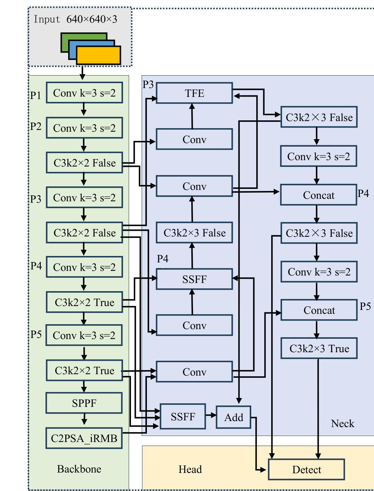

<div align="center">

# YOLOv11n-C2PSA-iRMB-ASF

**Lightweight Mulberry Pest & Disease Detection with Raspberry Pi Deployment**

**Authors: Fengling Liang, Rikun Wei (Hechi University)**  
**Paper: Improved YOLOv11n for Mulberry Pest and Disease Detection**

[简体中文](README.md) | [English](README.en.md)


</div>

---

## Overview

This repository contains a YOLOv11n-based detector for six classes of mulberry pests and diseases, together with the full training/evaluation pipeline and an edge deployment stack (PyTorch → TorchScript → pnnx → NCNN) running on a Raspberry Pi 4B.

Two structural changes are introduced:

1. **C2PSA-iRMB** — the PSABlock inside C2PSA is replaced by an iRMB dual-branch block (depthwise convolution + multi-head self-attention) to improve fine-grained feature extraction for small targets.
2. **ASF-style neck** — `Zoom_cat` aligns features across scales, `ScalSeq` models cross-scale sequences, and `Add` aggregates the result.



Dataset: 6 classes. The paper reports 2140 images / 2962 instances; the released data directory contains 2023 images / 2941 instances (1378 train / 645 val).

## Results

| Model | Precision | Recall | mAP50 | mAP50-95 | Params | GFLOPs |
| --- | ---: | ---: | ---: | ---: | ---: | ---: |
| YOLOv11n baseline | 87.63 | 76.04 | 83.59 | 55.87 | 2.59 M | 6.45 |
| + C2PSA-iRMB | 86.68 | 77.24 | 84.14 | 56.97 | 2.61 M | 6.46 |
| **+ C2PSA-iRMB + ASF (ours)** | **86.82** | **79.16** | **84.50** | **57.43** | **2.98 M** | **7.83** |

Metrics are taken from the best checkpoint (`exp34`, epoch 226). Raspberry Pi 4B with NCNN runs at **438 ms/frame (~2.3 FPS)** at 640×640 FP32.

| Training curves | PR curve |
| --- | --- |
|  |  |

## Quick start

```bash
conda create -n mulberry python=3.10 -y
conda activate mulberry
pip install -r requirements.txt
pip install -e . --no-deps

# put the dataset at datasets/mulberry/ (see dataset/README.md)
python train.py --data dataset/mulberry.yaml --device 0
python val.py --weights weights/best.pt --data dataset/mulberry.yaml --device 0
python detect_pc.py --source assets/samples --all
python app.py          # Gradio UI at http://127.0.0.1:7860
```

Raspberry Pi deployment:

```bash
ssh pi@raspberrypi.local "mkdir -p ~/mulberry"
scp -r deploy/* pi@raspberrypi.local:~/mulberry/
ssh pi@raspberrypi.local
cd ~/mulberry
python3 -m venv venv
./venv/bin/pip install -r requirements-pi.txt

sudo cp systemd/*.service /etc/systemd/system/
sudo systemctl daemon-reload
sudo systemctl enable --now mulberry mulberry-daemon
```

Full ablation and mainstream-model comparison tables are in the [Chinese README](README.md). The 24/7 daemon writes `runtime/latest.jpg`, `status.json` and daily CSV logs; adjust `User`/paths in `deploy/systemd` if your Pi user is not `lfl`. See [`deploy/README.md`](deploy/README.md) for details. The Android WebView client is in [`android_app/`](android_app/README.md).

## Repository layout

```text
ultralytics/                 modified YOLO11 source (C2PSA-iRMB, ASF, comparison modules)
train.py / val.py            training and validation entry points
detect_pc.py / run_test.py   PC inference
app.py                       Gradio web UI
weights/best.pt              final checkpoint
results/                     metrics, curves, ablation and comparison tables
dataset/                     dataset YAML template (images not included)
deploy/                      Raspberry Pi NCNN + Web + C++
android_app/                 Android WebView client source
tools/                       statistics and plotting utilities
docs/paper.docx              manuscript
```

## Not included

The dataset (~7.2 GB), full `runs/` (~4 GB), the PyInstaller `.exe` (2.7 GB, above GitHub's 2 GB release-asset limit), `pnnx.exe` (64 MB) and pretrained `yolo11n.pt` are not committed. See the Chinese README for details.

## License

The repository contains modified Ultralytics YOLO source and is distributed under **AGPL-3.0**. Commercial/closed-source use requires an Ultralytics Enterprise License. Third-party module credits are in [`ACKNOWLEDGEMENTS.md`](ACKNOWLEDGEMENTS.md).

## Citation

```bibtex
@misc{liang2026yolov11n,
  title  = {YOLOv11n-C2PSA-iRMB-ASF: Lightweight Mulberry Pest and Disease Detection with Edge Deployment},
  author = {Liang, Fengling and Wei, Rikun},
  year   = {2026},
  url    = {https://github.com/lfl0402/YOLOv11n-C2PSA_iRMB-ASF}
}
```
