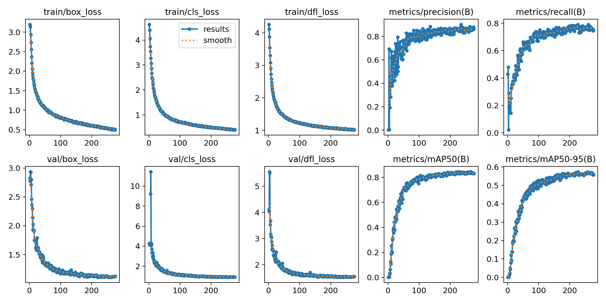
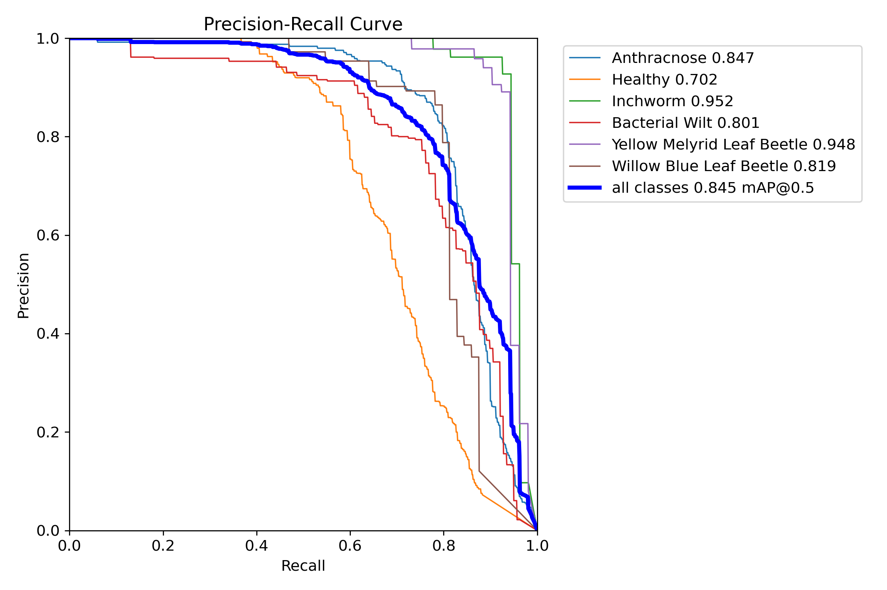
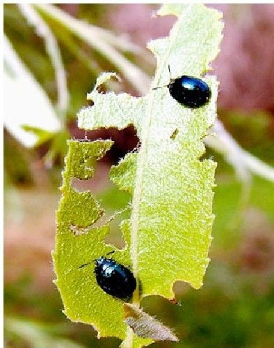
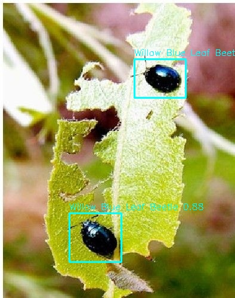
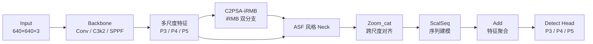

<div align="center">

# YOLOv11n-C2PSA-iRMB-ASF

**桑叶病虫害检测 · 轻量化改进 · 树莓派边缘部署**

[简体中文](README.md) | [English](README.en.md)


</div>

---

## 项目简介

本项目面向**桑叶病虫害实时检测**，在 YOLOv11n 上做了两处结构改进，并完成了从训练、评估到**树莓派 4B + NCNN + Web/Android** 的边缘部署全流程。

- **C2PSA-iRMB**：用 iRMB 的双分支（深度可分离卷积 + MHSA）替换 C2PSA 内部的 PSABlock，增强单尺度小目标的细粒度特征提取。
- **ASF 风格 Neck**：用 `Zoom_cat` 做跨尺度特征对齐，用 `ScalSeq` 做跨尺度序列建模，再用 `Add` 聚合，替代部分标准 `Concat`/上采样路径。
- **边缘部署**：PyTorch → TorchScript → pnnx → NCNN，树莓派 4B 上 **438 ms/帧（约 2.3 FPS）**，并提供 Gradio 网页端与 Android WebView 客户端。

数据集：6 类桑叶病虫害，2023 张图像、2941 个标注实例，按约 7:3 划分（1378 训练 / 645 验证）。

## 主要结果

| 模型 | Precision | Recall | mAP50 | mAP50-95 | 参数量 | GFLOPs |
| --- | ---: | ---: | ---: | ---: | ---: | ---: |
| YOLOv11n 基线 | 87.63 | 76.04 | 83.59 | 55.87 | 2.59 M | 6.45 |
| + C2PSA-iRMB | 86.68 | 77.24 | 84.14 | 56.97 | 2.61 M | 6.46 |
| **+ C2PSA-iRMB + ASF（本文）** | **86.82** | **79.16** | **84.50** | **57.43** | **2.98 M** | **7.83** |

- 相比基线：mAP50 **+0.91** 个百分点，Recall **+3.12** 个百分点，mAP50-95 **+1.56** 个百分点。
- 指标取 `best.pt` 对应轮次（`exp34`，第 226 轮，早停于 276）。
- 小目标“尺蠖”的 mAP50 达到 **95.2%**。

| 训练曲线 | PR 曲线 |
| --- | --- |
|  |  |

| 输入示例 | 树莓派端检测结果 |
| --- | --- |
|  |  |

更多曲线、混淆矩阵和对比实验 PR 曲线见 [`results/`](results/README.md)。

## 网络结构



核心改动文件：

| 文件 | 作用 |
| --- | --- |
| [`ultralytics/nn/Addmodules/iRMB.py`](ultralytics/nn/Addmodules/iRMB.py) | `iRMB` 与 `C2PSA_iRMB` 实现 |
| [`ultralytics/nn/Addmodules/ASFYOLO.py`](ultralytics/nn/Addmodules/ASFYOLO.py) | `Zoom_cat`、`ScalSeq` 实现 |
| [`ultralytics/nn/Addmodules/__init__.py`](ultralytics/nn/Addmodules/__init__.py) | 自定义模块的容错导入（缺少 mmcv/basicsr 时跳过，不影响主模型） |
| [`ultralytics/nn/tasks.py`](ultralytics/nn/tasks.py) | 注册 `Addmodules` 中的模块 |
| [`ultralytics/cfg/models/11/MY/yolo11-C2PSA-iRMB-ASFYOLO-1.yaml`](ultralytics/cfg/models/11/MY/yolo11-C2PSA-iRMB-ASFYOLO-1.yaml) | 最终模型配置 |

## 数据集

数据**不随仓库分发**（原始目录约 7.2 GB，且涉及版权/隐私）。按下面的结构放到 `datasets/mulberry/`：

```text
datasets/mulberry/
├── train/images/     # 1378 张
├── train/labels/
├── valid/images/     # 645 张
└── valid/labels/
```

```yaml
# dataset/mulberry.yaml
path: ../datasets/mulberry
train: train/images
val: valid/images

nc: 6
names:
  - Anthracnose                  # 炭疽病
  - Healthy                      # 健康叶片
  - Inchworm                     # 尺蠖
  - Bacterial Wilt               # 青枯病
  - Yellow Melyrid Leaf Beetle   # 黄斑叶甲
  - Willow Blue Leaf Beetle      # 柳蓝叶甲
```

完整类别分布与获取方式见 [`dataset/README.md`](dataset/README.md)。

## 快速开始

### 1. 环境

```bash
conda create -n mulberry python=3.10 -y
conda activate mulberry

# 先按你的 CUDA 版本安装 PyTorch，例如：
# pip install torch torchvision --index-url https://download.pytorch.org/whl/cu121
pip install -r requirements.txt

# 以可编辑模式安装本仓库修改过的 ultralytics（避免使用 pip 上的原版）
pip install -e . --no-deps
```

### 2. 训练

```bash
# 默认就是最终模型配置
python train.py --data dataset/mulberry.yaml --device 0

# 复现消融实验
python train.py --model ultralytics/cfg/models/11/yolo11.yaml \
                --data dataset/mulberry.yaml --device 0 --name baseline
python train.py --model ultralytics/cfg/models/11/yolo11-C2PSA-iRMB.yaml \
                --data dataset/mulberry.yaml --device 0 --name irmb
```

论文设置：640×640、300 epochs、batch 48、SGD、AMP、`close_mosaic=0`、`patience=50`。

### 3. 验证与推理

```bash
python val.py --weights weights/best.pt --data dataset/mulberry.yaml --device 0

# 批量检测 assets/samples
python detect_pc.py --source assets/samples --all

# 单张检测
python run_test.py assets/samples/47.jpg
```

### 4. PC 网页端

```bash
python app.py
# 浏览器打开 http://127.0.0.1:7860
```

支持单张检测、批量检测、检测明细表和类别统计；模型权重默认读取 `weights/best.pt`。

### 5. 树莓派部署

```bash
ssh pi@raspberrypi.local "mkdir -p ~/mulberry"
scp -r deploy/* pi@raspberrypi.local:~/mulberry/
ssh pi@raspberrypi.local
cd ~/mulberry
python3 -m venv venv
./venv/bin/pip install -r requirements-pi.txt
chmod +x webapp.sh
./webapp.sh start
```

访问 `http://<树莓派IP>:7860`。完整步骤、systemd 自启、C++ 版本和模型导出见 [`deploy/README.md`](deploy/README.md)。

### 6. Android 客户端

用 Android Studio 打开 [`android_app/`](android_app/README.md)，修改 `MainActivity.java` 中的服务器地址后构建。默认地址为 `http://raspberrypi.local:7860`。

## 仓库结构

```text
.
├── ultralytics/                 # 修改后的 YOLO11 源码
│   ├── cfg/models/11/MY/        # 改进模型与对比实验 YAML
│   └── nn/Addmodules/           # iRMB / ASFYOLO / 对比模块
├── train.py / val.py            # 训练与验证入口
├── detect_pc.py / run_test.py   # PC 端检测
├── app.py                       # Gradio PC 网页端
├── weights/best.pt              # 最终权重（6 MB）
├── results/                     # 指标、曲线、消融/对比表
├── dataset/                     # 数据配置模板（不含图像）
├── deploy/                      # 树莓派 NCNN + Web + C++
├── android_app/                 # Android WebView 客户端源码
├── tools/                       # 统计/绘图脚本
└── docs/paper.docx              # 论文稿
```

## 没有上传的内容

| 内容 | 体积 | 原因 |
| --- | ---: | --- |
| `dataset0224/` 图像与标签 | ~7.2 GB | 版权/隐私；GitHub 不适合存数据集 |
| `runs/` 全部 61 次训练输出 | ~4.0 GB | 只保留精选结果，完整日志按需提供 |
| `dist/桑叶病虫害检测系统.exe` | 2.7 GB | 超过 GitHub Release 单文件 2 GB 限制；请本地用 PyInstaller 构建 |
| `pnnx.exe` | 64 MB | Windows 专用转换工具；从 [pnnx Releases](https://github.com/pnnx/pnnx/releases) 下载 |
| `yolo11n.pt` / `yolov8n.pt` 预训练权重 | 11 MB | Ultralytics 会自动下载 |
| Android `build/`、`.gradle/`、APK | — | 构建产物，换网络后 IP 失效；用源码重新构建 |

如果你确实需要完整训练输出或数据集，请通过仓库主页联系作者。

## 口径说明（投稿/答辩前请核对）

- **参数量**：论文表 2 中最终模型写作 2.60 M；本仓库按 `weights/best.pt` 实测为 **2.98 M / 7.83 GFLOPs**，差异主要来自 ASF 分支的 `ScalSeq`/`Add` 结构。README 与 `results/` 使用实测值。
- **数据量**：论文表 1 写作 2140 张 / 2275 个实例；当前 `dataset0224` 实际为 **2023 张 / 2941 个实例**（1378 训练 + 645 验证）。README 与 CSV 使用实际计数，建议投稿前统一口径。
- **指标轮次**：所有表格取 `best.pt` 对应轮次，而不是最后一轮；`exp34` 最佳轮次是 226，早停于 276。
- **原始汇总表**：项目根目录的 `all_experiments_metrics.csv` 把 `mAP50-95` 列误当成了 `mAP50`（所以 exp34 显示 57.43）；[`results/all_runs.csv`](results/all_runs.csv) 已按 `results.csv` 重新计算。

## 许可证

本仓库包含并修改了 [Ultralytics YOLO](https://github.com/ultralytics/ultralytics) 源码，整体按 **AGPL-3.0** 分发，见 [`LICENSE`](LICENSE)。

- 学术研究、教学、开源项目可直接使用。
- 若需闭源商用/嵌入商业产品，请向 Ultralytics 申请 Enterprise License。
- 第三方模块（iRMB、ASF-YOLO、YOLOv11 改进合集等）的来源与引用见 [`ACKNOWLEDGEMENTS.md`](ACKNOWLEDGEMENTS.md)。

## 引用

```bibtex
@misc{liang2026yolov11n,
  title  = {YOLOv11n-C2PSA-iRMB-ASF: Lightweight Mulberry Pest and Disease Detection with Edge Deployment},
  author = {Liang, Fengling and Wu, Shenglan},
  year   = {2026},
  url    = {https://github.com/lfl0402/YOLOv11n-C2PSA_iRMB-ASF}
}
```

如果这个项目对你有帮助，欢迎 Star ⭐。
